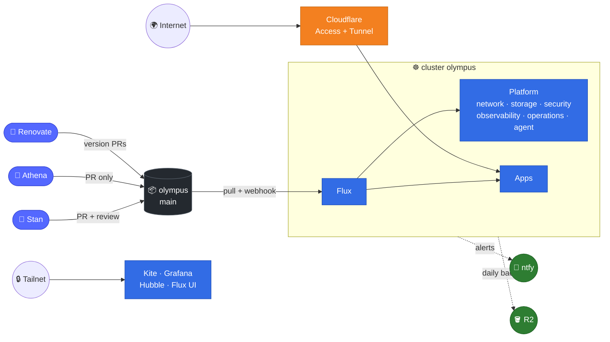
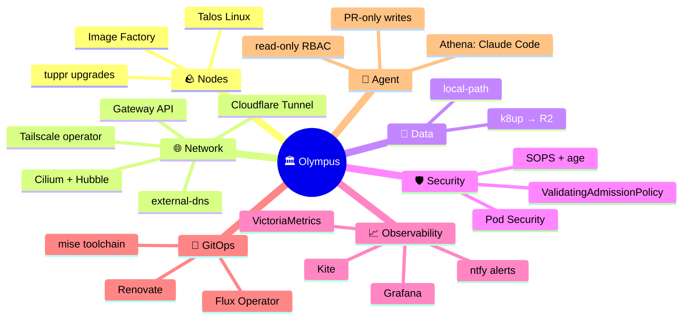
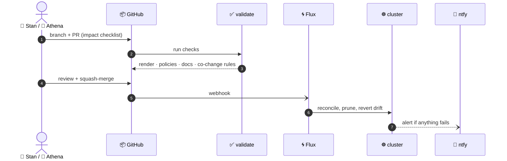
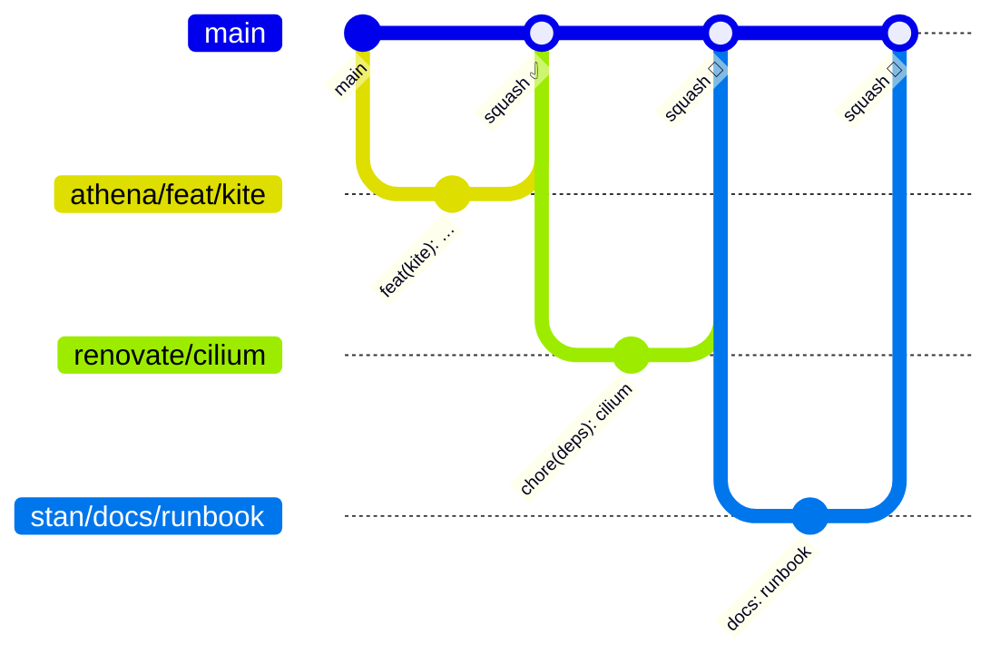
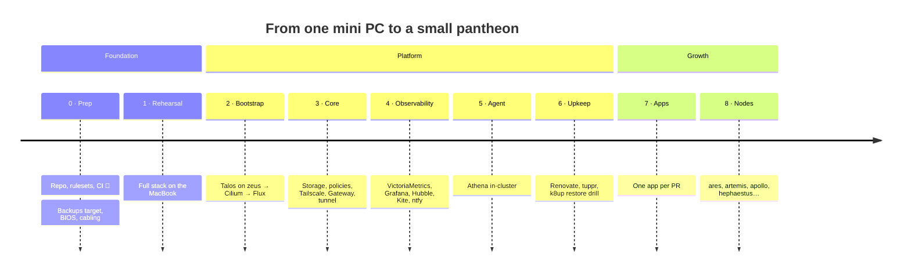

<div align="center">

# 🏛️ Olympus

**A GitOps Kubernetes homelab on Talos Linux: declared in git, reconciled by Flux, watched over by Athena.**

[](https://github.com/ZiineZ/olympus/actions/workflows/validate.yaml)


-D97757?style=flat-square&logo=claude&logoColor=white)

</div>

> [!IMPORTANT]
> **Git is the only way in.** Nothing on this cluster is changed by hand: no `kubectl apply`, no click-ops, no SSH (Talos has none). Every change is a pull request, and Flux reverts anything that drifts.

> [!TIP]
> New here? Read in this order: [conventions](../00-docs/conventions.md) → [architecture](../00-docs/architecture.md) → [decisions](../00-docs/decisions/).

---

## 🗺️ How it fits together



## 🧱 The layers

Every folder is a layer, numbered in the order it's built. A layer only depends on the ones before it.

| | Layer | What lives there | Applied by |
|:-:|---|---|---|
| 📚 | [`00-docs`](../00-docs/) | design, rules, decisions, runbooks | humans |
| 🪨 | `01-talos` | the node operating system, as config | Stan, `mise run talos:apply` |
| 🚀 | `02-bootstrap` | Cilium + Flux, used once per build | Stan, `mise run bootstrap:apps` |
| 🌀 | `03-cluster` | the Flux entrypoint and cluster-wide primitives | Flux |
| 🏗️ | `04-platform` | shared infrastructure, in six ordered groups | Flux |
| 📦 | `05-apps` | the actual services | Flux |

<details>
<summary><b>🧭 The stack at a glance</b></summary>



</details>

## 🔁 The life of a change



<details>
<summary><b>🌿 Branching model</b></summary>



`main` is protected: every change is a PR, the `validate` check must be green, history is linear, and Athena's PRs need Stan's approval. The rulesets are code in [`.github/settings/`](settings/).

</details>

## 🛣️ Roadmap



## 🏺 The pantheon

Machines and the agent are named after Greek gods; everything inside the cluster uses plain upstream names. **zeus** rules today, **athena** maintains, and new workers take the next name in line. See [ADR-0002](../00-docs/decisions/0002-naming-greek-pantheon.md).

## 🧠 Principles

> Git is the only source of truth · every fact lives once · every UI is read-only · structural limits beat instructions · boring by default · the cluster is cattle, the data is a pet.
>
> All of them: [ADR-0001](../00-docs/decisions/0001-guiding-principles.md)

<details>
<summary><b>📂 Repo map</b></summary>

```
olympus/
├── 00-docs/            architecture · conventions · inventory (generated) · decisions/ · runbooks/
├── 01-talos/           cluster.yaml · patches/ · schematics/
├── 02-bootstrap/       helmfile (cilium → flux)
├── 03-cluster/         flux entrypoint · cluster-settings · priority classes · components/
├── 04-platform/        01-network · 02-storage · 03-security · 04-observability · 05-operations · 06-agent
├── 05-apps/            one folder = one app = one namespace
├── .claude/            Athena's instructions + skills
├── .github/            this README · CI · checks · co-change rules · repo settings as code
└── .config/            mise toolchain + tasks
```

</details>

<div align="center">
<sub>Built and maintained with 🦉 Athena (Claude Code). Every change arrives through a pull request.</sub>
</div>
