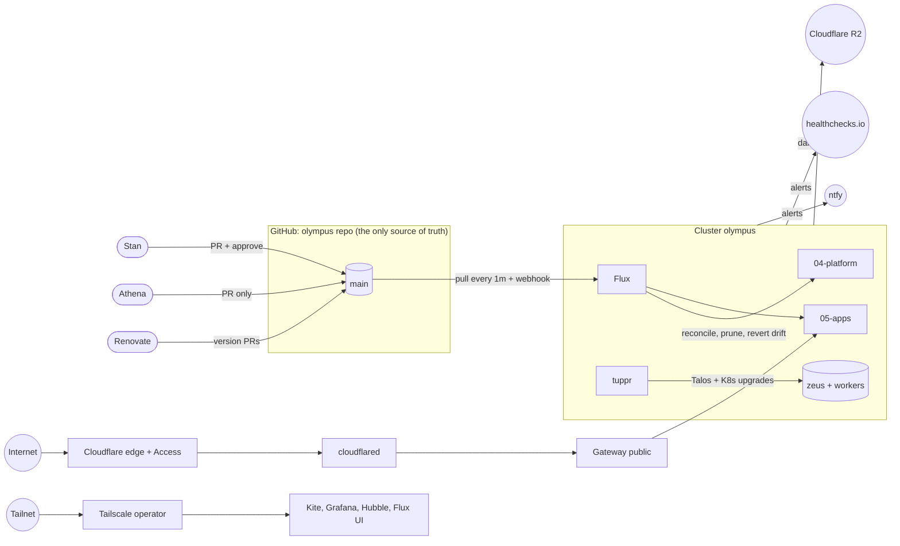

# Olympus architecture

Olympus is a GitOps-managed Kubernetes cluster built on Talos Linux. It starts as one node (zeus) and is designed to grow to seven without restructuring. This file is **living**: it describes the system *as it is now*, with every Accepted ADR applied. The reasons behind each choice are in [`decisions/`](decisions/). Current versions are listed in `inventory.md`, which is generated from the first component onward.

## 1. The big picture



**Who can change what:**

| Actor | Can read | Can change |
|---|---|---|
| Stan (daily) | everything except Secrets, over the tailnet | git, through PRs he approves |
| Stan (break-glass) | everything | the cluster directly, with the admin kubeconfig or `talosctl` (`runbooks/break-glass.md`). The change is then back-ported to git right away. |
| Athena | everything except Secrets | git, through PRs only. It cannot merge. |
| Renovate | the repo | git, through version PRs. Only an allow-listed few auto-merge. |
| Flux | git | the cluster, and nothing else does |

## 2. Layers

The repo's numbered folders are the build and dependency order ([ADR-0003](decisions/0003-repository-layout.md)).

| Layer | Folder | What it is | Applied by |
|---|---|---|---|
| 0 | `00-docs` | design, rules, decisions, runbooks | humans |
| 1 | `01-talos` | node OS config | `mise run talos:apply` (Stan) |
| 2 | `02-bootstrap` | Cilium + Flux, used once per build | `mise run bootstrap:apps` (Stan) |
| 3 | `03-cluster` | Flux entrypoint, cluster settings, priority classes, shared components | Flux |
| 4 | `04-platform` | shared infrastructure in groups `01-network` through `06-agent` | Flux, in group order |
| 5 | `05-apps` | Stan's services | Flux |

**Flux dependency chain:** `03-cluster` → `01-network` → `02-storage` → `03-security` → `04-observability` → `05-operations` → `06-agent` → `05-apps`.

## 3. Nodes

The node inventory lives only in `01-talos/cluster.yaml`: names, IPs, roles, install disks, and which image schematic (`01-talos/schematics/`) each node boots. The generated table is in `inventory.md`.

- **zeus** is the only control plane and the only `olympus/tier=heavy` node. It runs etcd and all stateful workloads, and it is the only node with node-level Tailscale access.
- **Workers** (`olympus/tier=light`) run stateless workloads. Their names are taken in order from the pantheon list in [ADR-0002](decisions/0002-naming-greek-pantheon.md).
- **The API endpoint is the VIP**, not zeus's address. Adding control planes later changes nothing for clients.
- **Memory behavior is deliberate.** There is no swap, and kubelet reserves and evicts early. Memory limit equals request, and PriorityClasses decide who is evicted first: Athena, then apps, then platform. A runaway process is killed quickly instead of starving the node, unlike the July 2026 incident.

## 4. Network

The full plan is in [ADR-0009](decisions/0009-network-addressing-and-hardware.md).

- **The LAN** is `192.168.50.0/24`, behind Stan's own router, which sits behind the dorm repeater (double NAT). There is no port forwarding.
- **Inside the cluster:** pods use `10.244.0.0/16` and services use `10.96.0.0/12`. Cilium does native routing, replaces kube-proxy, and runs Hubble.
- **Shared values** (LoadBalancer pool, and later domain and tailnet) come from `03-cluster/cluster-settings.yaml`, the only list of them. Manifests reference them as `${VAR}`. A variable is added with its first user; the `render` check fails on one that is undefined or unused.

### Traffic paths

```
Public:   browser → Cloudflare (TLS, Access, WAF) → tunnel "olympus" → cloudflared pod
          → Gateway "public" (Cilium) → HTTPRoute → Service → Pod
          (DNS records: external-dns from HTTPRoutes, owner "olympus")

Admin:    Stan's device (tailnet) → <ui>.<tailnet>.ts.net → Tailscale proxy → Service → Pod
kubectl:  Stan's device (tailnet) → olympus-k8s.<tailnet>.ts.net (API proxy, identity → olympus:viewers)
Talos:    Stan's Mac → zeus over the LAN or the tailnet (Talos tailscale extension) → Talos API
```

Not offered: LAN-only hostnames, NodePorts, `hostNetwork` apps ([ADR-0011](decisions/0011-traffic-exposure.md)).

## 5. Control loops: how drift is prevented

| Loop | What it keeps true | Interval |
|---|---|---|
| Flux GitRepository | the cluster's view of `main` | 1m, plus a GitHub webhook |
| Flux Kustomizations | every object in git exists, and objects removed from git are pruned | 10m |
| Flux HelmRelease drift detection | live Helm-managed objects match their release | 30m |
| Admission policies (Pod Security + VAP) | nothing non-compliant enters the API | every request |
| tuppr | nodes run the Talos and Kubernetes versions in git | on change |
| Renovate | pinned versions don't go stale | weekly |
| CI `validate` | git itself is consistent: render, schema, policies, docs, co-changes | every PR |
| Alerts → ntfy | Stan learns about failures, drift reverts, stale backups | continuous |

## 6. Data

- **Storage:** the only StorageClass is `local-path`, on zeus's NVMe. Reclaim policy is `Retain` and there is no replication ([ADR-0016](decisions/0016-storage-local-path.md)).
- **Backups:** k8up, using restic, backs up every opted-in namespace daily to Cloudflare R2. Retention is 7 daily, 4 weekly, 6 monthly ([ADR-0017](decisions/0017-backups-k8up.md)).
- **Disaster recovery:** reinstall Talos, run the bootstrap, Flux rebuilds everything, then a PR adds the Restore CRs. The targets are an RPO of 24h and an RTO of about 1h ([ADR-0025](decisions/0025-disaster-recovery-and-rehearsal.md)).

## 7. Observability

- **Metrics:** VictoriaMetrics k8s stack (VMSingle, VMAgent, VMAlert, Alertmanager) plus node-exporter, kube-state-metrics, and metrics-server.
- **Dashboards:** Grafana, read-only, provisioned from git. Hubble UI shows live flows. The Flux Web UI shows reconcile state. Kite gives the all-in-one view: resources, logs, metrics, and AI Q&A.
- **Alerts:** VMAlert → Alertmanager → ntfy. A `Watchdog` heartbeat pings healthchecks.io, which raises its own alert if the cluster goes silent.
- **Logs:** streamed live through Kite and kubectl. No log store yet ([ADR-0026](decisions/0026-deferred-decisions-register.md)).

## 8. Agent

Athena is Claude Code running in namespace `athena` ([ADR-0024](decisions/0024-agent-athena.md)).

- **Talking to it:** `kubectl exec -it -n athena deploy/athena -- claude`, over the tailnet.
- **Its limits:** it reads through `view` and `olympus-cluster-read` (no Secrets, no exec, no writes). It writes only by opening PRs through its GitHub App, which has no `workflows` permission.
- **Its network:** egress is locked to the Anthropic API, GitHub, the kube-apiserver, VMSingle, and Hubble Relay. Its memory is capped at 2Gi.
- **How it works:** its knowledge entrypoint is the `olympus` skill, and every change goes through the `change` skill.
- **Its memory:** long-term memory is this repo; session memory lives on its PVC.

## 9. Applications

None yet. Phase 1 is the platform only. Apps arrive one per PR through the `add-component` skill (they use `app-template`, one namespace each). This section lists them once they exist.

## 10. Outside git (known and accepted)

| Thing | Why it isn't in git | Where it's documented |
|---|---|---|
| age private key, restic password | they are the keys to everything else | password manager + paper ([ADR-0014](decisions/0014-secrets-sops-age.md)) |
| Cloudflare Access apps and policies | not yet managed as code | `runbooks/03-core.md` (deferred: OpenTofu) |
| GitHub App installs (Renovate, Athena) | GitHub account UI | `runbooks/00-prep.md`. Rulesets and repo settings themselves are code in `.github/settings/` |
| healthchecks.io check | external service | `runbooks/04-observability.md` |
| Router DHCP pool range | router UI | `runbooks/00-prep.md` |
| BIOS settings (zeus, workers) | firmware | [ADR-0009](decisions/0009-network-addressing-and-hardware.md), `runbooks/08-add-node.md` |
